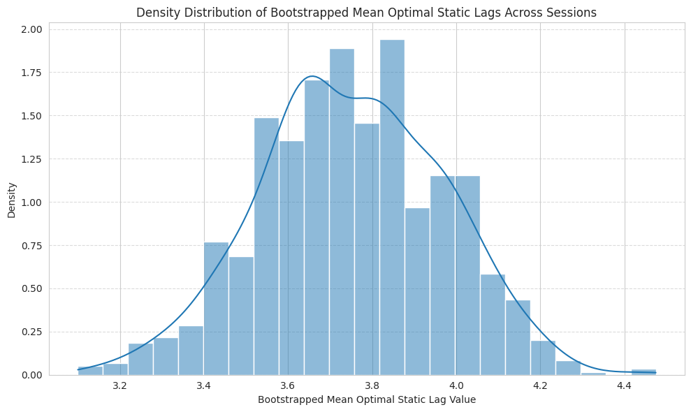
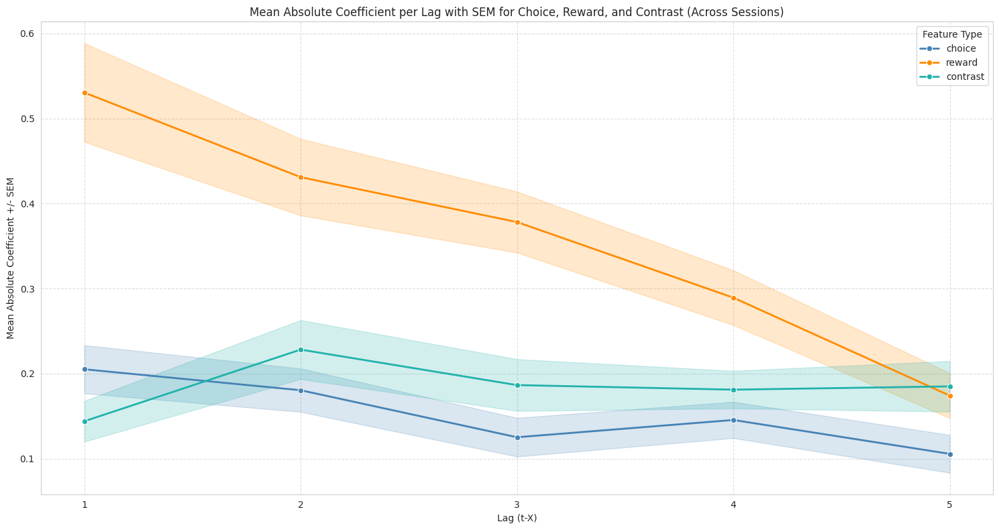
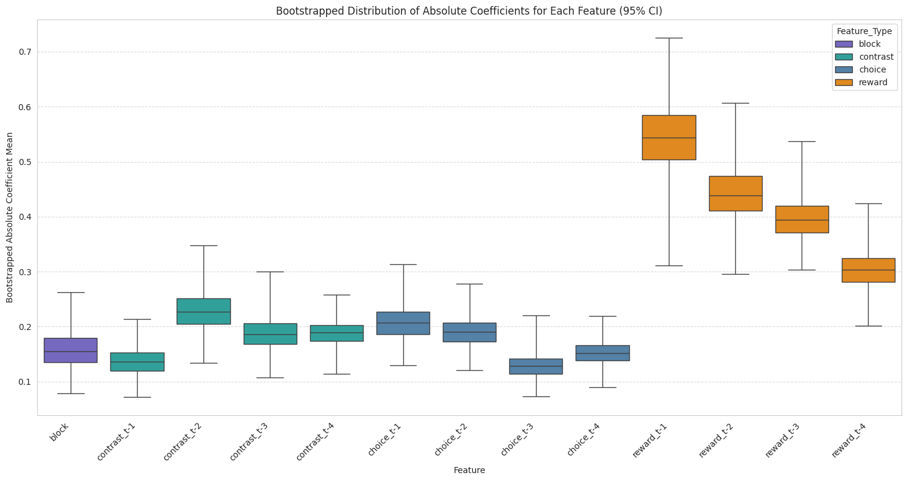

# IBL History-Dependent Behavioral Analysis

This repository contains an analysis of behavioral data from the **International Brain Laboratory (IBL)** dataset, focusing on how information from previous trials contributes to behavior on the current trial.

The analysis examines whether recent **choice history, reward history, lagged sensory evidence (contrast), and block structure** have measurable and potentially different temporal influences on behavior. Rather than considering only the immediately preceding trial, the analysis evaluates multiple temporal lags to characterize how far back information from previous trials may contribute to the current behavioral response.

## Analysis Overview

The central idea is to represent previous-trial information using lagged predictors. For a behavioral variable \(X\), the analysis considers:

\[
X_{t-1}, X_{t-2}, X_{t-3}, \ldots
\]

where \(X_{t-k}\) represents the value of that variable \(k\) trials before the current trial.

Separate lagged predictors are considered for:

- **Choice history**
- **Reward history**
- **Contrast / sensory evidence history**
- **Block structure**

The behavioral response is modeled using **logistic regression**. Because the response is binary, the logistic regression coefficients describe the association between each historical predictor and the probability of the behavioral response on the log-odds scale. Separate lagged predictors are entered into the logistic regression models to estimate how choice, reward, contrast, and block structure at different temporal lags relate to the current behavioral response.

An important modeling choice is that **contrast on the current trial, \(C_t\), was not considered as an input predictor**. Current-trial contrast has an obviously strong and direct effect on the current behavioral response, so including it would dominate the model and obscure the history-dependent effects of interest. Therefore, contrast enters the analysis only through its lagged history terms, such as \(C_{t-1}, C_{t-2}, C_{t-3}, \ldots\).

To assess the stability of the estimated history dependence across sessions, the analysis uses **cross-validation and bootstrapping**. These procedures allow the temporal structure of the effects to be examined across sessions rather than relying on a single session.

A particular focus is placed on the **optimal static lag**, representing the history length selected by the analysis as providing the best model performance. The distribution of this quantity across sessions provides an overview of the temporal scale of the historical information captured by the models.

---

# Results

## 1. Distribution of Optimal Static Lag

**Figure 1. Density distribution of bootstrapped mean optimal static lag values across sessions.**

This figure shows the distribution of the bootstrapped mean optimal static lag obtained across sessions. The mean optimal static lag is **3.75 trials**, with a **95% bootstrapped confidence interval of [3.33, 4.17]**. The values are concentrated approximately between 3.5 and 4.1 trials, with the highest density around the middle of this range.

The distribution indicates that the model does not consistently select a very short history. Instead, the analysis suggests that information from several previous trials can contribute to the behavioral model.

The spread of the distribution also indicates variability across the bootstrapped estimates, suggesting that the estimated temporal scale is not represented by a single fixed value across all resampled analyses.

---

## 2. Mean Absolute Coefficient Across History Lags

**Figure 2. Mean absolute logistic-regression coefficient per lag for choice, reward, and lagged contrast across sessions. Shaded regions represent ± SEM.**

This figure compares the magnitude of the estimated logistic-regression coefficients across temporal lags for the three behavioral variables.

The **reward coefficients** show the largest absolute magnitude, with the strongest effect at the most recent lag and a gradual decrease as the lag increases. This pattern suggests that more recent reward information has a stronger association with the modeled behavioral response than reward information further in the past.

The **choice-history coefficients** are smaller in magnitude than the reward coefficients and remain relatively modest across the tested lags. Their pattern indicates a weaker but persistent contribution of previous choices.

The **contrast coefficients** show a different temporal profile. Their magnitude increases from lag 1 to lag 2 and then remains relatively stable across the later lags shown. Importantly, these contrast effects are based only on **lagged contrast predictors**; current-trial contrast \(C_t\) was not included as an input predictor because it has an obviously dominant effect on the current behavioral response.

Because the figure displays **absolute coefficient values**, it describes the magnitude of the association rather than whether the relationship is positive or negative.

---

## 3. Bootstrapped Coefficient Distributions

**Figure 3. Bootstrapped distributions of absolute logistic-regression coefficients for block, lagged contrast, choice, and reward across the analyzed lags.**

This figure provides the distribution of bootstrapped absolute coefficient estimates for each feature and temporal lag.

The **reward-history coefficients** show the largest magnitudes overall, particularly for the most recent reward history. Their magnitude decreases progressively across later lags, consistent with the pattern observed in Figure 2.

The **choice-history coefficients** are smaller than the reward coefficients, with the largest values occurring at the first few lags. The distributions also show variability in the estimated magnitude across bootstrap samples.

The **contrast coefficients** remain within a relatively narrower range across the tested lags, with contrast at \(t-2\) showing a comparatively larger coefficient magnitude than the other contrast lags. Current-trial contrast \(C_t\) is not shown because it was not used as an input predictor.

The **block** predictor is included as a separate feature and shows a coefficient magnitude within the range of the other non-reward predictors.

Together, the distributions illustrate both the relative magnitude of the different historical predictors and the uncertainty/variability of their estimated coefficients across bootstrap samples.